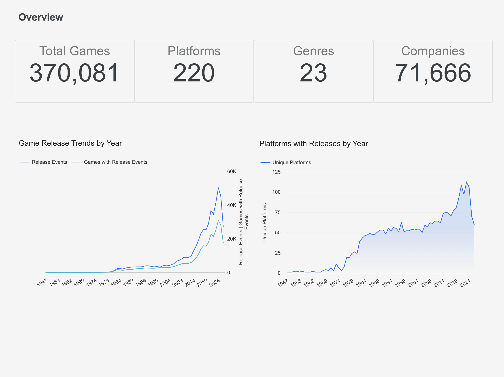
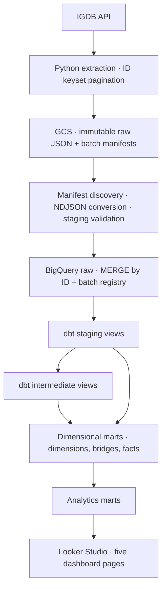

# IGDB Gaming Analytics

A Data Engineering portfolio project that transforms IGDB game metadata into BigQuery analytics and a five-page Looker Studio dashboard. Built with Python ingestion, immutable GCS batches, and dbt dimensional models.

## Technology stack

| Purpose | Technologies |
| --- | --- |
| Ingestion | ![Python 3.11][badge-python] ![uv][badge-uv] |
| Storage and transformation | ![Google Cloud Storage][badge-gcs] ![BigQuery][badge-bigquery] ![dbt Core][badge-dbt] |
| Analytics | ![Looker Studio][badge-looker] |
| Infrastructure and development | ![Terraform][badge-terraform] ![Docker][badge-docker] ![Git][badge-git] |
| Testing and code quality | ![pytest][badge-pytest] ![Ruff][badge-ruff] |

## Live dashboard

**[Explore the Looker Studio dashboard →](https://datastudio.google.com/reporting/5f8316d4-6de2-4821-923f-601822531579/page/e1tAG?hl=en)**

Five pages explore release activity, platform catalogs, genres, company roles, and current user/critic ratings.



## Engineering highlights

- **Immutable extraction:** ID keyset pagination across six IGDB endpoints, with page-level JSON and batch manifests in GCS.
- **Recoverable loading:** manifest discovery, validated NDJSON conversion, a batch registry, and retry selection.
- **Idempotent BigQuery loads:** staging count and ID checks before `MERGE` by source ID.
- **Dimensional modeling:** dbt views and tables with explicit entity, relationship, event, and rating grains.
- **Reliable analytical counts:** separate platform catalog and release aggregations to avoid many-to-many fanout, supported by Python and dbt tests.

## Architecture



The pipeline is run manually. Terraform defines cloud resources; automated orchestration remains future work. See [architecture details](docs/architecture.md).

## Pipeline and data modeling

The extractor supports `games`, `platforms`, `genres`, `companies`, `involved_companies`, and `release_dates`. The loader discovers completed manifests, converts JSON arrays to NDJSON under `load_ready/`, validates a reusable `stg_<endpoint>` table, and merges into the raw endpoint table. Raw BigQuery tables retain one current row per ID; GCS retains the original extraction objects subject to bucket retention policies.

The default datasets are `gaming_raw`, `gaming_dev`, and `gaming_prod`. dbt staging renames source keys and derives calendar dates; intermediate models unnest relationships and deduplicate records.

| Layer | Models | Grain |
| --- | --- | --- |
| Dimensions | `dim_games`, `dim_platforms`, `dim_genres`, `dim_companies` | One row per source entity ID |
| Bridges | `bridge_game_platforms`, `bridge_game_genres` | One row per game/platform or game/genre pair |
| Company fact | `fct_game_companies` | One row per involved-company ID, with role flags |
| Release fact | `fct_game_releases` | One row per release-date ID |
| Rating fact | `fct_game_ratings` | One current rating row per game |
| Analytics | `games_release_trends` | One row per non-null release year |
| Analytics | `genre_performance`, `platform_performance`, `company_performance` | One row per genre, platform, or company |
| Analytics | `top_rated_games` | One row per game |

Release events and distinct games are different measures. Platform catalog membership comes from game-platform arrays; company metrics count distinct games by role. Ratings represent the current loaded state; the build date does not provide historical snapshots. See the [marts model](docs/data_model/marts_model.md) and [data dictionary](docs/data_dictionary.md).

## Data Quality & Limitations

Staging validation and dbt tests cover counts, keys, and relationships. The October 12, 2026 audit verified **572,631 fact releases from 574,447 raw records (99.68% retention)**, with no observed date-lineage or aggregation discrepancies in the checked platform and yearly marts.

IGDB metadata can be incomplete or approximate. Releases without loaded games are excluded; missing dates do not enter yearly trends. Recorded game release dates are not platform launch dates, and ratings retain current state only. These results describe a historical snapshot, not a guarantee of source accuracy.

See [detailed findings and limitations](docs/data_quality.md) for all verified metrics, date-precision methodology, and audit scope.

## Dashboard gallery

Screenshots show a loaded snapshot and may include display filters. The Overview preview appears above; the table links to all five full-size images.

| Page | Focus |
| --- | --- |
| [Overview](docs/images/dashboard/01-overview.png) | Entity counts and yearly release trends |
| [Platforms & Releases](docs/images/dashboard/02-platforms-releases.png) | Catalog size, release events, and recorded date ranges |
| [Genres & Ratings](docs/images/dashboard/03-genres-ratings.png) | Genre coverage and current rating comparisons |
| [Companies](docs/images/dashboard/04-companies.png) | Distinct game participation by company role |
| [Ratings Explorer](docs/images/dashboard/05-ratings-explorer.png) | Game-level scores and rating counts |

## Setup and configuration

Use Python 3.11 and uv. Cloud runs require Twitch/IGDB application credentials, an existing GCP project, a GCS bucket, and permissions for Cloud Storage and BigQuery. Terraform and Docker are optional for the manual workflow below.

### Install dependencies

From the repository root:

```bash
cp .env.example .env
cp dbt/profiles/profiles.yml.example dbt/profiles/profiles.yml
make setup
```

### Configure credentials

Fill `.env` locally with `TWITCH_CLIENT_ID`, `TWITCH_CLIENT_SECRET`, `GCP_PROJECT_ID`, `GCP_REGION`, `GCS_BUCKET_NAME`, `GOOGLE_APPLICATION_CREDENTIALS`, and the three `BQ_*_DATASET` values. Use an absolute path to a service-account JSON key stored outside the repository. Both ingestion CLIs explicitly load that key; ADC alone does not replace it. Keep credentials, filled profiles, `.env`, and Terraform variable/state files out of Git.

The example dbt **dev** target uses OAuth Application Default Credentials:

```bash
gcloud auth application-default login
```

The **prod** target uses the service-account key path. Ensure the configured location matches the datasets. The profile example fixes authentication, threads, and priority per target; `DBT_BIGQUERY_METHOD`, `DBT_*_THREADS`, and `DBT_BIGQUERY_PRIORITY` in `.env.example` do not override those profile settings.

Makefile targets load the root `.env`. For direct dbt commands, export its variables into the current shell first (the Python CLIs read that file themselves):

```bash
set -a
source .env
set +a
```

For optional infrastructure configuration, use `terraform/terraform.tfvars.example` and the `make terraform-init` / `make terraform-validate` targets. Infrastructure deployment is a separate step; the commands below assume resources are available.

## Running the pipeline

### Extract and load a sample

A small extraction can demonstrate ingestion without repeating the full historical backfill. These commands contact cloud services; extraction writes GCS objects and loading writes BigQuery tables.

```bash
# From the repository root
cd ingestion
uv run python -m igdb_pipeline.cli extract --endpoint games --page-size 500 --max-pages 2
uv run python -m igdb_pipeline.load_cli discover --endpoint games
uv run python -m igdb_pipeline.load_cli run --endpoint games --max-batches 1 --dry-run
uv run python -m igdb_pipeline.load_cli run --endpoint games --max-batches 1
```

Selection is by pending batch, so `--max-batches 1` may select an older batch; use `--batch-id <batch-id>` to target the extraction you just created. Repeat extraction/loading for the other supported endpoints to supply all six dbt sources. A games-only sample does not populate the complete analytical model. Existing GCS batches can be loaded without re-extraction; failed loads can be selected with `--retry-failed`.

### Build models, test, and generate documentation

From the repository root, after exporting the environment variables:

```bash
make dbt-debug
make dbt-build-dev
cd dbt
uv run dbt test --profiles-dir profiles --target dev
uv run dbt docs generate --profiles-dir profiles --target dev
uv run dbt docs serve --profiles-dir profiles
```

`dbt build` runs models and tests; the standalone test command reruns tests on existing models. Documentation generation may query BigQuery. Use `make dbt-build-prod` only when intentionally targeting production.

### Local development checks

From the repository root:

```bash
make ingestion-test
make ingestion-lint
```

## Project structure

```text
ingestion/             Python extraction, loading, CLI, and tests
dbt/                   Sources, models, tests, and profile example
terraform/             GCS, BigQuery, and IAM resource definitions
docs/                  Architecture, model documentation, and screenshots
notebooks/             API exploration
sql/                   Exploratory and validation workspaces
dashboards/            Presentation workspaces
Makefile               Installation and development commands
```

## Data source and attribution

Video game metadata is provided by **[IGDB (Internet Game Database)](https://www.igdb.com/)** through the **[IGDB API](https://api-docs.igdb.com/#getting-started)**. Credit goes to IGDB and its contributors for the source data used in this project.

[badge-python]: https://img.shields.io/badge/Python-3.11-3776AB?style=flat-square&logo=python&logoColor=white
[badge-uv]: https://img.shields.io/badge/uv-DE5FE9?style=flat-square&logo=uv&logoColor=white
[badge-gcs]: https://img.shields.io/badge/Google_Cloud_Storage-4285F4?style=flat-square&logo=googlecloudstorage&logoColor=white
[badge-bigquery]: https://img.shields.io/badge/BigQuery-4285F4?style=flat-square&logo=googlebigquery&logoColor=white
[badge-dbt]: https://img.shields.io/badge/dbt_Core-FF694B?style=flat-square&logo=data%3Aimage%2Fsvg%2Bxml%3Bbase64%2CPHN2ZyBmaWxsPSJ3aGl0ZSIgcm9sZT0iaW1nIiB2aWV3Qm94PSIwIDAgMjQgMjQiIHhtbG5zPSJodHRwOi8vd3d3LnczLm9yZy8yMDAwL3N2ZyI%2BPHBhdGggZD0iTTE3LjkwMDQgOS4zNzYzYTguMTQ4OCA4LjE0ODggMCAwIDAtMy4wNDIxLTMuMTIwNmwxLjc3MDguODM4NWExMC4yODc0IDEwLjI4NzQgMCAwIDEgMy43NCAzLjAwMDdsMy4yMzQtNS45Mjk1YTIuODU0NiAyLjg1NDYgMCAwIDAtLjA2MTEtMi45NjA0QzIyLjc1NjYuMDM3MSAyMS4yMTEyLS4zNDA5IDE5Ljk3NTQuMzMyN2wtNS44NzQ5IDMuMjEwMWE0LjM2MTIgNC4zNjEyIDAgMCAxLTQuMTc2MSAwTDQuMTc2OS40MDhhMi44NTQ1IDIuODU0NSAwIDAgMC0yLjk1OTIuMDYzMmMtMS4xNjczLjc4NTMtMS41NDUyIDIuMzMtLjg3MjMgMy41NjU1TDMuNTUgOS45MTA2YTQuMzYxMiA0LjM2MTIgMCAwIDEgMCA0LjE3NzJsLTMuMTI3MiA1Ljc0M2EyLjg2IDIuODYgMCAwIDAgLjA4NSAyLjk5NzRjLjc5NCAxLjE0MzggMi4zMjI1IDEuNTA1NCAzLjU0NDguODM4NWw2LjA1ODEtMy4zMDQ5YTEwLjI4NzcgMTAuMjg3NyAwIDAgMS0zLjAwNTEtMy43NDU0bC0uODM3NC0xLjc3MDhhOC4xNDggOC4xNDggMCAwIDAgMy4xMjA2IDMuMDQyMWwxMC41ODMyIDUuNzc5YzEuMjIxMy42NjYgMi43NDgxLjMwNTUgMy41NDI2LS44MzYzYTIuODY5OSAyLjg2OTkgMCAwIDAgLjA3OTYtMy4wMDE4TDE3LjkwMDQgOS4zNzYzem0zLjM4MDEtNy43MzUxYy42MDIyIDAgMS4wOTA0LjQ4ODIgMS4wOTA0IDEuMDkwNHMtLjQ4ODIgMS4wOTA0LTEuMDkwNCAxLjA5MDQtMS4wOTA0LS40ODgyLTEuMDkwNC0xLjA5MDQuNDg4Mi0xLjA5MDQgMS4wOTA0LTEuMDkwNHpNMi43NDQyIDMuODIyYy0uNjAyMiAwLTEuMDkwNC0uNDg4Mi0xLjA5MDQtMS4wOTA0cy40ODgyLTEuMDkwNCAxLjA5MDQtMS4wOTA0IDEuMDkwNC40ODgyIDEuMDkwNCAxLjA5MDRTMy4zNDY0IDMuODIyIDIuNzQ0MiAzLjgyMnptMCAxOC41MzYzYy0uNjAyMiAwLTEuMDkwNC0uNDg4Mi0xLjA5MDQtMS4wOTA0IDAtLjYwMjIuNDg4Mi0xLjA5MDQgMS4wOTA0LTEuMDkwNHMxLjA5MDQuNDg4MiAxLjA5MDQgMS4wOTA0YzAgLjYwMjItLjQ4ODIgMS4wOTA0LTEuMDkwNCAxLjA5MDR6bTEwLjM1ODUtMTEuNDQ4OWMtMS4yMDA4LS4wMDM1LTIuMTc3Ljk2NzItMi4xODA1IDIuMTY3OWEyLjE3MzggMi4xNzM4IDAgMCAwIC43MDUyIDEuNjA5MWMtMS40ODcyLS4yMDkxLTIuNTIzNC0xLjU4NDMtMi4zMTQyLTMuMDcxNi4yMDkxLTEuNDg3MiAxLjU4NDMtMi41MjM0IDMuMDcxNi0yLjMxNDJhMi43MTk0IDIuNzE5NCAwIDAgMSAyLjMxNDIgMi4zMTQyIDIuMTYyMyAyLjE2MjMgMCAwIDAtMS41OTYzLS43MDU0em04LjE3NzggMTEuNDQ4OWMtLjYwMjIgMC0xLjA5MDQtLjQ4ODItMS4wOTA0LTEuMDkwNCAwLS42MDIyLjQ4ODItMS4wOTA0IDEuMDkwNC0xLjA5MDRzMS4wOTA0LjQ4ODIgMS4wOTA0IDEuMDkwNGMwIC42MDIyLS40ODgyIDEuMDkwNC0xLjA5MDQgMS4wOTA0eiIvPjwvc3ZnPg%3D%3D
[badge-looker]: https://img.shields.io/badge/Looker_Studio-4285F4?style=flat-square&logo=looker&logoColor=white
[badge-terraform]: https://img.shields.io/badge/Terraform-844FBA?style=flat-square&logo=terraform&logoColor=white
[badge-docker]: https://img.shields.io/badge/Docker-2496ED?style=flat-square&logo=docker&logoColor=white
[badge-git]: https://img.shields.io/badge/Git-F05032?style=flat-square&logo=git&logoColor=white
[badge-pytest]: https://img.shields.io/badge/pytest-0A9EDC?style=flat-square&logo=pytest&logoColor=white
[badge-ruff]: https://img.shields.io/badge/Ruff-D7FF64?style=flat-square&logo=ruff&logoColor=black
