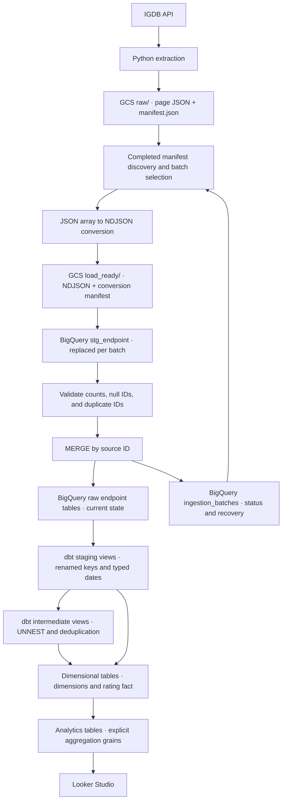

# Architecture

The implemented workflow is manual batch processing. Python extracts six IGDB endpoints using ID keyset pagination, writes immutable page JSON to GCS, and finishes each batch with a completed or failed manifest.

## Storage and loading

Raw object paths use `raw/<endpoint>/load_type=historical/extraction_date=<date>/batch_id=<id>/`. Uploads use a create-only GCS generation precondition. The loader never edits these source objects; converted NDJSON lives separately under `load_ready/`.

A batch registry records processing state. Completed manifests are selected for loading, while loaded batches are skipped and failed batches require retry selection. Staging uses `WRITE_TRUNCATE`; a validated batch is merged into its endpoint table by ID. This supports repeatable loading and recovery, while raw BigQuery tables represent current loaded state rather than change history.

Terraform defines the bucket, IAM grants for an existing service account, and `gaming_raw`, `gaming_dev`, and `gaming_prod` datasets. Bucket versioning and public-access prevention are configured. Create-only ingestion does not mean permanent retention: the Terraform bucket lifecycle includes age-based deletion. IAM includes bucket object administration and project-level BigQuery data editing; it is not a narrowly scoped production permission design.

## Transformation and serving

Staging and intermediate models are views; all marts are tables rebuilt by dbt. Game-platform and game-genre arrays become bridges. Release records join to loaded games before deduplication, excluding unmatched games. Dimensions and rating facts select the latest loaded row per ID. Analytics marts aggregate at year, genre, platform, company, or game grain.

Looker Studio consumes the analytics tables. dbt tests are executed when invoked through `dbt build` or `dbt test`; there is no implemented scheduled pipeline. Incremental extraction with a persisted watermark, orchestration, and CI/CD remain future work.
