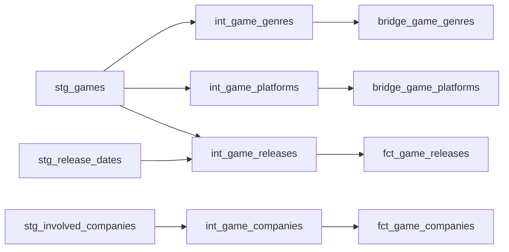

# Intermediate models

These dbt views prepare relationships for the existing dimensional marts.

| Model | Inputs | Grain and behavior | Consumer |
| --- | --- | --- | --- |
| `int_game_genres` | `stg_games` | Distinct non-null game/genre pairs from `UNNEST(genres)` | `bridge_game_genres` |
| `int_game_platforms` | `stg_games` | Distinct non-null game/platform pairs from `UNNEST(platforms)` | `bridge_game_platforms` |
| `int_game_companies` | `stg_involved_companies` | One row per involved-company ID; latest `updated_at`, then `_loaded_at`; non-null keys; null role flags become false | `fct_game_companies` |
| `int_game_releases` | `stg_release_dates`, `stg_games` | One row per release-date ID; inner join to loaded games; latest `updated_at`, then `_loaded_at` | `fct_game_releases` |

Relationship tests validate referenced games, genres, platforms, and companies; the genre/platform dimensions are not joined by the corresponding intermediate views. See the [marts model](marts_model.md) for downstream grains and metric semantics.
