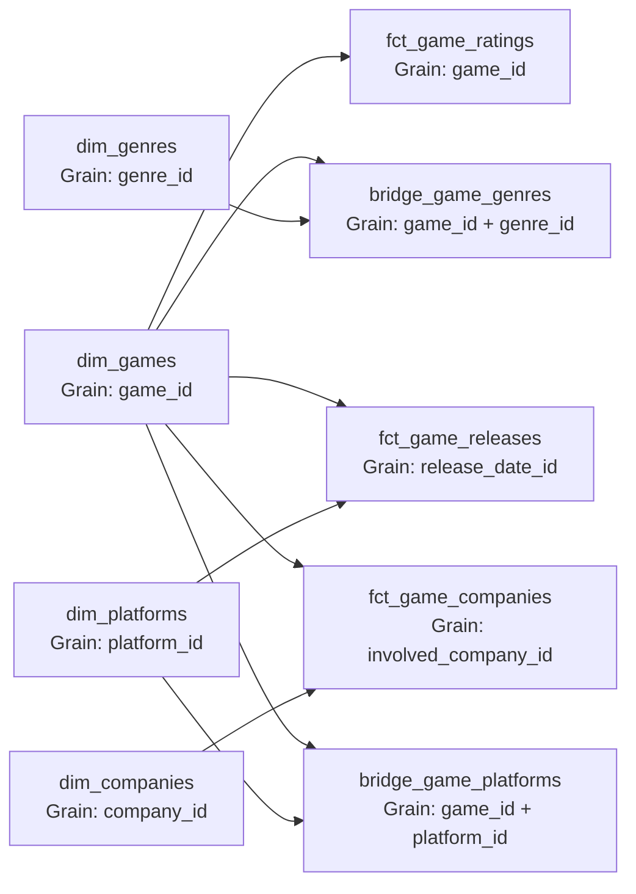
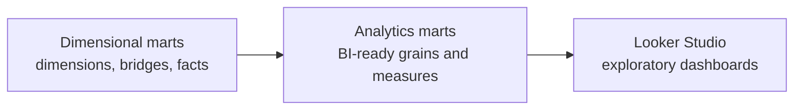

# IGDB marts data model

The marts layer preserves IGDB identifiers as analytical keys. Dimensions hold
the current descriptive state, bridges resolve independent many-to-many
relationships, and facts preserve their declared event or relationship grain.

`fct_game_ratings` contains only the current loaded rating state. Its
`snapshot_date` records the build date, but the table is replaced on every run
and therefore does not provide historical snapshots.

## BI analytics marts

The analytics layer provides several narrow, predictable-grain BigQuery tables
that Looker Studio can consume independently. It intentionally does not create a
universal flattened table.

| Analytics model | Grain | Primary use |
| --- | --- | --- |
| `games_release_trends` | One row per non-null release year | Yearly release-event, distinct-game, and platform trends |
| `genre_performance` | One row per genre | Genre coverage and current user/critic rating comparisons |
| `platform_performance` | One row per platform | Platform catalog size, release-event volume, and date range |
| `company_performance` | One row per company | Distinct game participation by company role |
| `top_rated_games` | One row per game | Flexible current-rating rankings and confidence filters |

### Metric semantics and caveats

- A **release event** is one row in `fct_game_releases`. A game can have
  multiple events across dates, platforms, regions, or release categories.
- A **distinct game** count deduplicates `game_id` within the model's declared
  grouping. In yearly trends, a game contributes at most once per year even if
  it has several releases that year.
- Null release dates remain in `fct_game_releases` but are excluded from
  `games_release_trends`, because they cannot be assigned to a calendar year.
- `fct_game_releases.release_date` is a BigQuery `DATE`. The source Unix integer
  and derived UTC timestamp remain available in the fact as
  `release_date_raw` and `release_timestamp` for lineage and debugging.
- A game with multiple genres contributes once to every assigned genre. Genre
  metrics do not join platform or release relationships, preventing unrelated
  many-to-many fanout.
- Platform catalog measures and release measures are aggregated separately at
  platform grain before being joined.
- Company participation measures count distinct games because multiple
  involvement records can exist for a company-game pair.
- **User ratings** use `rating` and `rating_count`. **Aggregated ratings** use
  `aggregated_rating` and `aggregated_rating_count` and represent critic or
  external aggregate scores supplied by IGDB.
- Rating models represent the current loaded state only. `snapshot_date` is the
  table build date and does not provide rating history.
