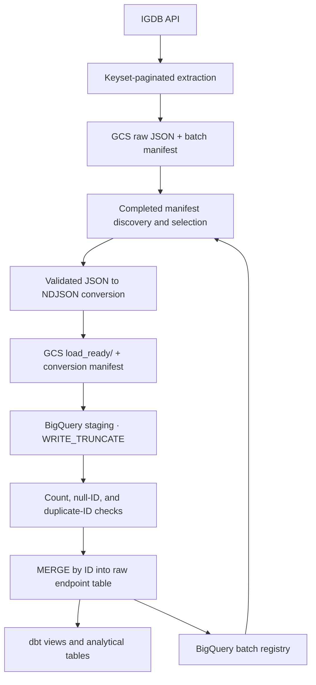

# IGDB ingestion

Run the commands below from `ingestion/` after completing the root
[setup instructions](../README.md#setup-and-configuration).

Historical extraction for the configured IGDB endpoints. Extraction uses
ID keyset pagination, uploads one immutable JSON object per page, and writes a
completed or failed batch manifest after page processing.

```bash
uv run python -m igdb_pipeline.cli extract \
  --endpoint games \
  --page-size 500 \
  --max-pages 2 \
  --start-after-id 0 \
  --load-type historical
```

Supported endpoints are `games`, `platforms`, `genres`, `companies`,
`involved_companies`, and `release_dates`. The legacy option-only CLI form and
`--limit` alias remain available.

## Loading existing GCS batches

The loader discovers completed `raw/**/manifest.json` batches, converts their
JSON arrays to validated NDJSON under `load_ready/`, loads a reusable staging
table, and merges one current row per ID into `gaming_raw`. It never modifies
the source objects.

Previewing is read-only (including BigQuery and GCS):

```bash
uv run python -m igdb_pipeline.load_cli run --endpoint games --max-batches 1 --dry-run
```

Load one batch, or inspect all manifests without registering them:

```bash
uv run python -m igdb_pipeline.load_cli run --endpoint games --max-batches 1
uv run python -m igdb_pipeline.load_cli discover
```

Use `--retry-failed` to select failed registry entries. `--batch-id` targets a
specific recovery batch. `--skip-conversion` is accepted only when an existing
conversion manifest and all of its files pass validation.

Invalid source Unix timestamps do not block a batch: the original value is
preserved and the derived `*_ts` field is written as `NULL`. A loader run exits
non-zero when one or more selected batches fail (after attempting all selected
batches), so failed batches can be recovered with `--retry-failed`.

## End-to-end workflow



The registry records conversion/loading status and failures. Raw GCS files stay
unchanged; raw BigQuery tables retain the current loaded row per ID. dbt modeling
is implemented and is invoked separately after loading. The extraction CLI
supports historical batches; persisted incremental watermarks and scheduled
orchestration remain future work.

`--max-batches` limits pending-batch selection, not extraction volume. Use
`--batch-id <batch-id>` to target a specific batch. A small games extraction alone
does not supply all six raw tables required by dbt.

The optional `scripts/run_historical_pipeline.sh` assumes an existing
`igdb-ingestion:local` Docker image, execution from `ingestion/`, and an exported
`GOOGLE_APPLICATION_CREDENTIALS` path. It processes only companies, games,
involved companies, and release dates, assuming platforms and genres are already
loaded. It is a full-backfill helper rather than a required demonstration step.
