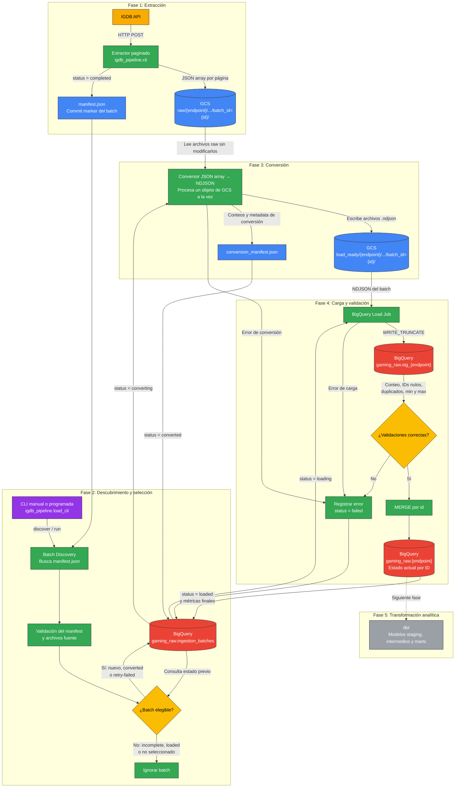

# IGDB ingestion

Generic historical extraction for the configured IGDB endpoints. Extraction uses
ID keyset pagination, uploads one immutable JSON object per page, and writes a
completed or failed batch manifest after page processing.

```bash
uv run python -m igdb_pipeline.cli extract \
  --endpoint games \
  --page-size 500 \
  --max-pages 2 \
  --start-after-id 0 \
  --load-type historical
```

Supported endpoints are `games`, `platforms`, `genres`, `companies`,
`involved_companies`, and `release_dates`. The legacy option-only CLI form and
`--limit` alias remain available.

## Loading existing GCS batches

The loader discovers completed `raw/**/manifest.json` batches, converts their
JSON arrays to validated NDJSON under `load_ready/`, loads a reusable staging
table, and merges one current row per ID into `gaming_raw`. It never modifies
the source objects.

Previewing is read-only (including BigQuery and GCS):

```bash
uv run python -m igdb_pipeline.load_cli run --endpoint games --max-batches 1 --dry-run
```

Load one batch, or inspect all manifests without registering them:

```bash
uv run python -m igdb_pipeline.load_cli run --endpoint games --max-batches 1
uv run python -m igdb_pipeline.load_cli discover
```

Use `--retry-failed` to select failed registry entries. `--batch-id` targets a
specific recovery batch. `--skip-conversion` is accepted only when an existing
conversion manifest and all of its files pass validation.



### 💡 Puntos clave reflejados en el flujo:
* raw/ es la zona original e inmutable.
* manifest.json determina si un batch es procesable.
* ingestion_batches controla estados, reintentos e idempotencia.
* load_ready/ contiene los archivos NDJSON compatibles con BigQuery.
* stg_* es temporal y se sobrescribe por batch.
* gaming_raw.* conserva una fila actual por id.
* dbt realizará después el modelado analítico y el UNNEST de relaciones.